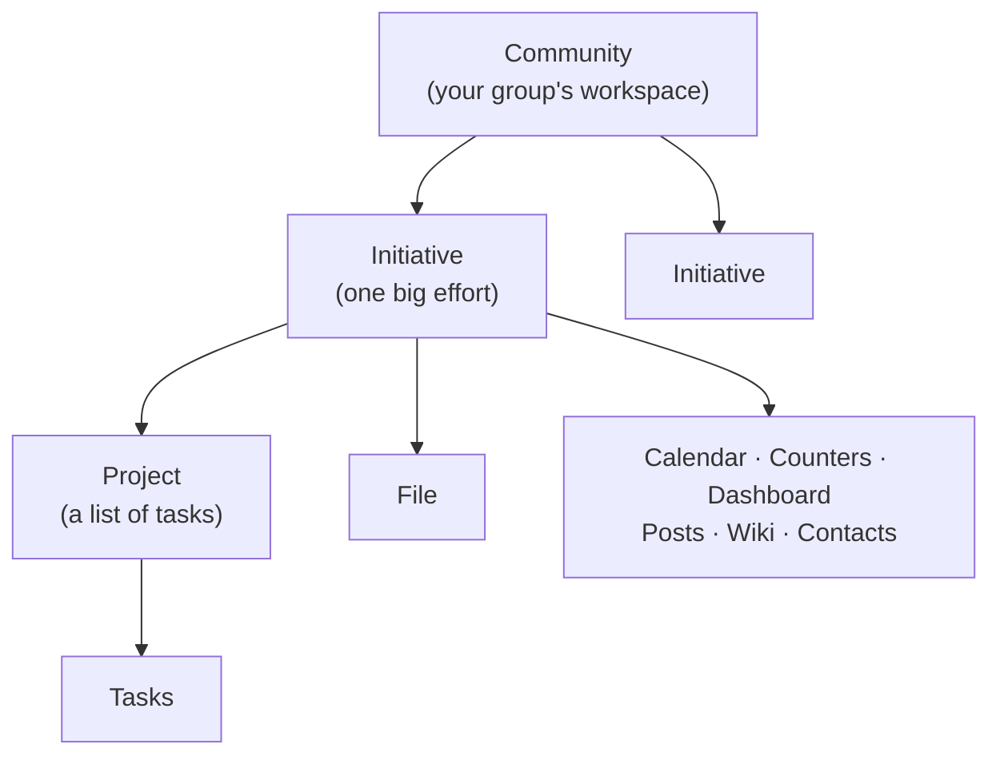

# How Initiative is organized

Everything in Initiative sits inside something bigger, and once you can picture how it nests, most of the app explains itself. This takes about four minutes, and then you can go back to your actual life.

## The big picture

From biggest to smallest:

1. **Community**: the whole workspace for one group of people.
2. **Initiative**: a folder inside it for one big effort.
3. **Tools**: the projects, files, calendars and so on that hold the work.
4. **Tasks**: the individual to-dos inside a project.

!!! tip "You don't have to build all of this"
    One initiative with one project in it is a complete setup, and plenty of groups run on exactly that for years. This is a map of what's available. It isn't a checklist, and you aren't behind.

## Community: your group's workspace

A community is one separate space for one group of people. Your small business, your volunteer committee and your neighborhood association would each get their own.

Communities don't mix, and nothing in one shows up in another. You can belong to several and switch between them on the rail down the left edge of the screen.

The one thing that spans them is you. The Initiative logo at the top of the rail opens [your own pages](../guides/your-space.md), which gather your tasks, events and messages from every community you're in. They show you nothing you couldn't already open, and they save you checking four communities to find out what you agreed to.

Most people in a community are **members**. **Admins** run it, and its **superadmin** also decides how people sign in and which plug-ins and AI it uses. See [Communities](../guides/communities.md).

!!! example "A running example"
    *Riverside Players* is a community theater group. They make one community for everything they do together, and inside it, one initiative per production.

## Initiative: one big effort

An initiative is a folder for one major undertaking, holding the tools that effort uses. It's also where you decide who's involved.

Why have a middle layer at all? Because real groups have four things going at once, and not everybody needs all four. The person running the raffle doesn't need the budget spreadsheet in their sidebar every morning.

!!! example "Continuing the example"
    Riverside Players make an initiative called *Spring Play: Our Town*. Into it go the rehearsal schedule, the budget, the script and the performance calendar.

    Only the spring play people are in it. The summer show crew never see it, and so they're never tempted to have an opinion about it.

A new community has no initiatives until you make one and name it after the work it holds. If you sign up with **For a group** or **Just for me**, the first one is made for you.

Everybody in an initiative has a **role** that decides which tools they can use. Every initiative comes with **Moderator**, **Project Manager** and **Member**, and you can add your own, like "Director" or "Cast". See [Initiative roles](../sharing/initiative-roles.md).

## Tools: the things that hold the work

Everything inside an initiative is a **tool**, and the tools all work alike. You share each one the same way, tag it, comment on it, and point at it with `#` from anything you write. Once you've learned one, you've mostly learned the next.

### The two you'll start with

**Projects** hold **tasks** and show them as a **Table**, a **Board** you drag cards across, a **Gantt** timeline or a **Calendar**. The person who thinks in tidy lists and the person who thinks in columns can share a project without either of them quietly suffering. See [Projects & tasks](../guides/projects-and-tasks.md).

**Files** hold what your group writes and collects: text documents, spreadsheets and whiteboards that several people can edit at once, plus uploads like the PDF somebody sent around in March. See [Files](../guides/files.md).

### The rest, when you grow into them

| Tool | What it's for |
|---|---|
| **Calendars** | Things that happen at a time, with RSVPs |
| **Counters** | Numbers that go up and down, like seats left or money raised |
| **Dashboards** | One screen that answers "how are we doing?" |
| **Posts** | A bulletin board, for things that need saying rather than doing |
| **Wikis** | Linked pages for what your group knows |
| **Contacts** | An address book of the people and places your work involves |

Each initiative switches its tools on and off, and projects and files are the ones on to begin with. If you never turn on the rest, nothing is missing. See [Tools](../guides/tools.md).

## Plug-ins: what other groups already built

The **marketplace** has ready-made dashboards, projects and plug-ins, built by people who had your problem first. A dashboard or a project lands in an initiative like any other tool. A plug-in adds something the whole community shares, so the community's superadmin adds it. See [Plug-ins & the marketplace](../guides/plugins-and-marketplace.md).

## Who can see what

Everything above is about where things live. The other half is who's allowed near them, and that works from the outside in:

| Layer | The question it answers |
|---|---|
| **Community** | Are you in this group at all? |
| **Initiative** | Are you part of this particular effort? |
| **Initiative role** | Which kinds of tools can you use here? |
| **Sharing** | For this one project or file, can you look, edit, or decide who else gets in? |

You reach a file only when all four say yes. Community admins are the exception, because somebody has to be able to find the thing that went missing: they can open everything in their own community.

It sounds like a lot of gates, and the payoff is that you rarely have to think about them. The people who see a thing are the people you put in front of it. [Sharing & access](../sharing/index.md) has the friendly version, and [Security & privacy](../security/index.md) has the technical one.

??? techspec "For the technically minded: these layers are enforced in the database"
    The **community** layer is structural. Each community's content lives in its own PostgreSQL schema, and a request routed into one can't address another's tables. The **initiative**, **role** and **sharing** layers are enforced inside that schema by row-level security on every statement, so the database has the final say rather than the application. Two overrides sit above them: a **community admin** has full access within their own community, and platform staff can hold **temporary, time-limited, recorded** access, never a standing one. The full model is in [How your data is kept separate](../security/how-your-data-is-kept-separate.md).

## Where to go next

- To start doing things, open [the how-to guides](../guides/index.md).
- To find out who can see what, read [Sharing & access](../sharing/index.md).
- For a word you don't recognize, try [the glossary](../reference/glossary.md), or search for it.
