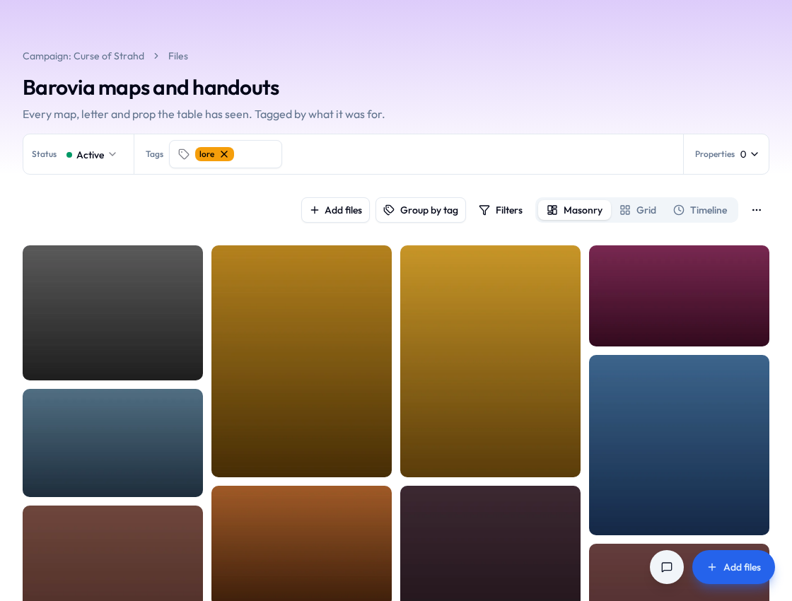

# Collections

A **collection** is a handful of files that belong together: the fall festival photos, the logo and the four logos that lost, everything the new treasurer needs (which is somehow eleven files, one of them a spreadsheet called `REAL one`).

Putting a file in a collection doesn't move it. It stays in [Files](files.md) the whole time, so nothing goes missing because somebody filed it somewhere clever, and a file can sit in as many collections as it suits.

An initiative's collections show as a row of cards above its files on the **Files** tab. Changing collections takes a role that can create files in the initiative; if you don't see **Add to collection**, ask an initiative manager.

## Put files in a collection

1. On the **Files** tab, open **More actions** (the **⋯**).
2. Select **Select items**.
3. Tick the files.
4. Select **Add to collection**.
5. Pick the collection.

From one file's own page, select **Add to collection** in the **Collections** box at the top and pick the collection.

If the collection [requires](layouts.md#required-fields) some values of its files, it asks for them first, once for the whole batch. Fill them in and select **Continue**.

## Start a new collection

A collection starts from files, so the first one is made the same way as above.

1. Select the files and choose **Add to collection**, as above.
2. Type a name in **New collection name**.
3. Select **Add to new collection**.
4. Choose how it starts: **Blank**, or one of the ready-made shapes below.
5. Optional: under **Or copy the shape of**, pick another collection to copy its properties and what its views show (without its files).
6. Check the **Name**.
7. Select **Create collection**.

| Shape | What it's for | Views | Properties |
|---|---|---|---|
| **Blank** | Anything | **Grid** and **Table** | None yet |
| **Gallery** | Pictures on a wall, with a caption under each | **Masonry**, **Grid**, **Timeline** | Caption |
| **Catalog** | Things to browse, each with a price and a rating | **Grid**, **Table** | Price, Rating |
| **Log** | Files kept by date, newest first | **Timeline**, **Table** | Date |

## Add files to a collection you're looking at

Open the collection from the row of cards on the **Files** tab, then:

- Drop files from your computer anywhere on the page to upload them straight in. **More actions** › **Upload files** does the same with a file picker.
- Select **Add files** and pick one that's already in Files.

A big batch shows its progress as it goes, and names any file that couldn't go up.

## Take files out of a collection

1. Open **More actions** › **Select items**.
2. Tick the files.
3. Select **Remove from collection**.

The files stay in Files. Take the last one out and the collection goes to the trash by itself. Restore one of those files from the trash and the collection comes back with it.

## Look through a collection

Pick a view from the row above the files:

| View | What it's for |
|---|---|
| **Grid** | Tiles, as many across as fit |
| **Table** | One row per file, for sorting |
| **Masonry** | Every picture at its own shape, packed into columns, for looking |
| **Timeline** | A row per day, by when each file joined, with a rail down the side for jumping between months |

**Group by tag**, beside the views on **Grid** and **Masonry**, gathers the files under each of their tags. **Filters** narrows the files, and in the picture views it has **Order**: **Newest first** or **Oldest first**.

Click a picture to see it full size, with the collection's details for it beside it, and arrow through the rest. Click any other file to open its details in a panel. **Open file** goes to the file itself.

## Choose what a collection shows

Each view and the file panel is a [layout](layouts.md) you can change: which views the collection offers and which it opens on, the table's columns, what each tile shows under the picture, and what sits beside a file when you open it. Changing them takes the right to set up layouts in the initiative.

1. Open the collection.
2. Open **More actions** and select **Layouts**.
3. Pick the layout to change.

The layout editor opens, the same one projects use. See [Layouts](layouts.md).

## Give a collection its own properties { #a-collections-properties }

A property is a value a file has in this collection only: a price, a rating, the day a photo was taken. The same photo can be "$40, four stars" in the shop catalog and just a picture in the festival gallery.

To make one:

1. Open the collection's **Layouts** and pick one, as above.
2. In the layout editor, choose **Add** where the property should go.
3. Type the property's name in the search box.
4. Under **New property**, pick what kind of value it is (**Text**, **Number**, **Date**, **Money**, **Scale** and so on).

Where a new property appears is the bit that surprises people. The file panel shows every property the collection has, so it appears there straight away. Tiles and the table show only what you add to them, so it sits off them until you do.

To fill a property in, open a file in the collection and type the value in its panel.

In the layout editor, select the layout's name at the top of the outline and the collection's properties are listed beside it, each with the layouts that show it. That's where they're renamed, reordered or deleted. Deleting one takes every file's value of it in this collection, so it asks first. **Initiative settings** › **Metadata** lists every collection's properties too, for tidying several at once (see [Working with initiatives](initiatives.md)).

An initiative's own [metadata](initiatives.md) travels with a file wherever it goes and can show here too. Properties are for what only makes sense in this collection.

### Make a property required

The file panel's layout can make a property [required](layouts.md#required-fields). After that, putting files in the collection asks for it first, and a file in the collection can't have it emptied. Files that were in before keep going without a value, marked so somebody fills it in. Each collection asks only for its own properties, so a photo in three collections answers each one separately.

## Rename, tag, archive or delete a collection

- Click the collection's name to rename it.
- Add tags and metadata in the box at the top.
- **Status** › **Archived** archives it, which makes it read-only until you set it back to **Active**.
- **More actions** › **Move to trash** deletes it, after asking. Its files stay where they are, and the collection can be restored from the trash until your community's retention period ends.

A collection has its own comments and [connections](mentions-and-links.md), like anything else.

!!! tip "A collection doesn't change who sees a file"
    Each file keeps its own sharing. Somebody opening a collection sees the files in it they could already open, and nothing else. If they can't open any of them, the collection doesn't show up for them at all.
