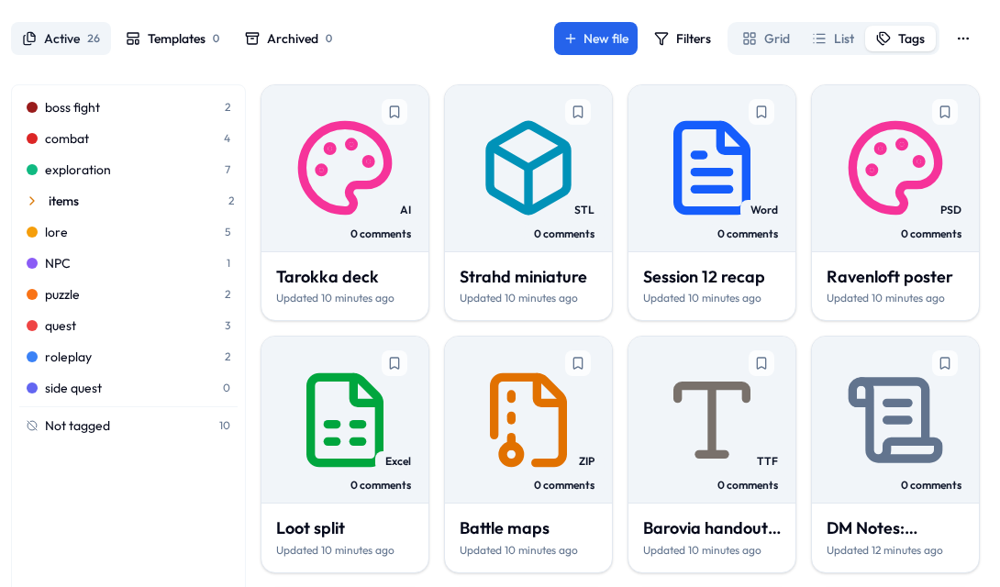
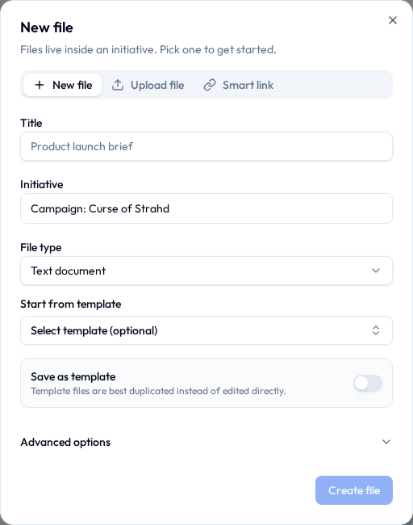
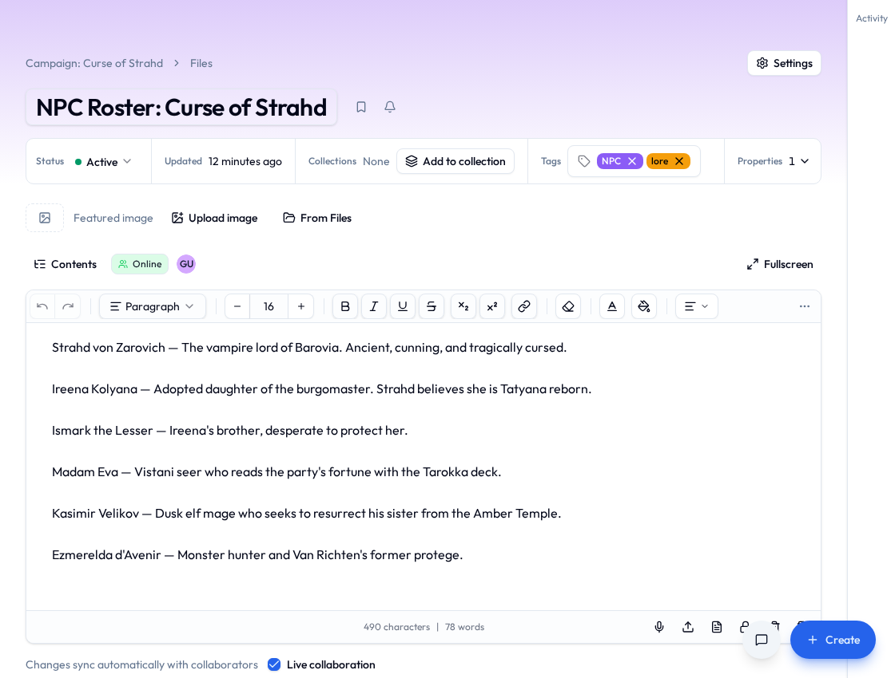
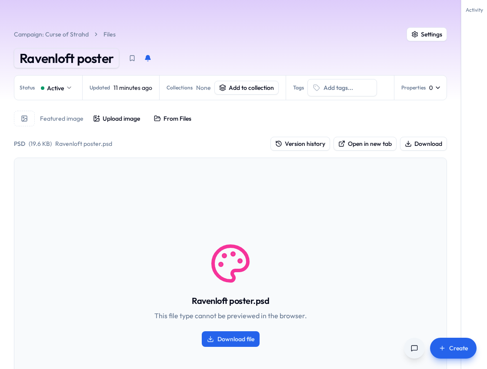
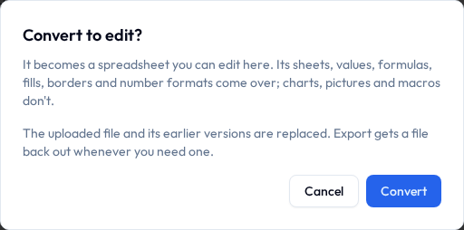
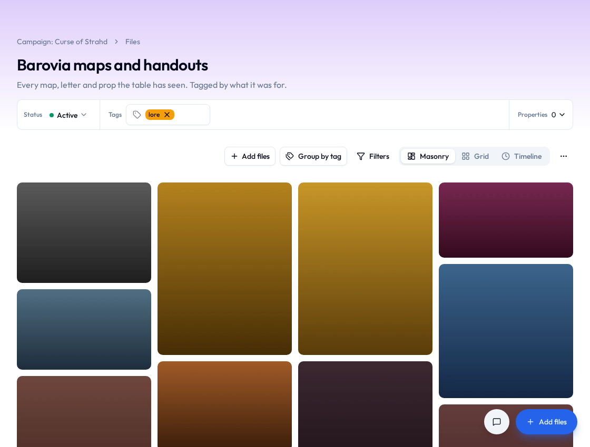

# Files

**Files** is where your group writes things down — notes, plans, scripts, budgets — and keeps the things it's been sent.

Files live inside an initiative, and most kinds can be edited by several people **at the same time**, live.

No emailing versions round. No `final_v3_ACTUAL_final.docx`. No wondering whether Dave is working on the old one.

## Kinds of file

| Type | What it's for |
|---|---|
| **Text document** | A page you write on, like a word processor. Notes, plans, write-ups. |
| **Spreadsheet** | A grid with formulas. Numbers, lists, tables. |
| **Whiteboard** | A blank canvas for sketching things out. |
| **Smart link** | An embedded view of something that lives somewhere else — a video, a shared file. |
| **Upload** | Something from your computer: PDF, Word, Excel, PowerPoint, images, and more. |

An upload can be any format but a program. Each one wears its category's icon and its format on a badge (**PSD**, **BLEND**, **ZIP**), so the poster's layered artwork stops looking like the minutes. Pictures, PDFs, video and audio open right on the page. Everything else has a **Download** button, and anyone who can see the file can use it.

**Filter by type** narrows the list to one category: design files, 3D models, fonts, camera raw, code, e-books, CAD drawings, compressed files, and the usual documents, spreadsheets and pictures.

Got the file on your desktop already? Drag it anywhere onto the files
page — any view — and **New file** opens on the **Upload file** tab with it
ready to go. Or drop it on the box in that tab instead of hunting for it in a
file picker.

!!! info "Big files are fine"
    Video, the forty-minute recording of the AGM, the photo archive somebody finally zipped up. A large file goes up in pieces, so if the Wi-Fi drops halfway, it carries on from where it stopped rather than starting again. Pick the same file again after closing the tab and it does the same. The only limit is your community's storage, if it has one.

## Making one

1. In an initiative, choose **New file**.
2. Pick the **type** — or the **Upload file** or **Smart link** tab.
3. Give it a **title** and confirm which **initiative** it belongs to.
4. Optionally start from a **template**.
5. Write. Or upload. Or draw.

{ width="520" }

## Writing a text document

The editor has what you'd expect: **bold, italic, underline**, headings, quotes, code blocks, bulleted and numbered lists, checklists, alignment, images, tables, columns, dividers, embedded video, and undo for when you change your mind.

Everything **autosaves**. There is no save button — which means there is no save button to forget to press at 11pm, and no version of this evening where you lose forty minutes of work to a browser tab.

A few keys do more than they look like they do:

- `@` mentions a person.
- `#` links to anything in the initiative. See [Mentions & links](mentions-and-links.md).
- `[[` links to another file — and offers to make one if the name is new.
- `.
- `/` opens the insert menu: images, tables, callouts, statuses, drawings, diagrams, embeds, and [smart chips](#smart-chips).

A few pieces are worth knowing by name:

| | |
|---|---|
| **Callouts** | A coloured panel for the thing nobody should miss — **Info**, **Note**, **Tip**, **Success**, **Warning** or **Error**. Unlike a quote it holds anything: lists, code, a table. Click its icon to change the kind, or to take the panel away and keep the words. The arrow in its corner folds the panel down to its first line — put a title there and a long aside becomes one line until somebody wants it. |
| **Statuses** | A word in a coloured pill — *Done*, *Blocked*, *Waiting on legal* — set by hand. Click one to change the word or the colour. For a status that keeps *itself* up to date, use a [smart chip](#smart-chips). |
| **Merged cells** | Drag across cells in a table and **Merge cells** from the table menu joins them into one; **Unmerge cells** splits it back. For the header that sits over three columns, and the row label that runs down two. |
| **Drawings** | A small whiteboard inside the page. Draw it, save it, and it sits there as a picture. **Edit drawing** opens it again. |
| **Diagrams** | Flowcharts, sequence diagrams and friends, written as text in [Mermaid](https://mermaid.js.org/) and drawn as you type. **Diagram** in the `/` menu starts one; any code block set to Mermaid is drawn the same way. Someone reading the page sees the picture, and the code stays out of their way. |

The **Markdown** button at the bottom of the editor shows the whole page as markdown and back. Callouts are written the way Obsidian writes them (`> [!warning]`, and `> [!warning]-` when folded), merged cells the way MultiMarkdown does (`||` and `^^`), columns as Pandoc's fenced divs (`:::: {.columns}`), a drawing as its scene in an `excalidraw` code block, a `#` link as `[[task:12|Roll call]]`, a smart chip as the same with the fact it shows (`[[task:12:status|Roll call]]`) and a mention as `@[Ada](4)`, so all of it survives the round trip — and a file from those tools pastes in and comes out right.

!!! note "Drawings in exports"
    A Markdown export keeps each drawing the same way. Word and PDF leave drawings out: a drawing is redrawn by the browser every time it's shown, and a printed page has no browser in it.

A long text document has a **Contents** list of its headings, nested the way you wrote them. Pick one and the page scrolls there; it marks where you are as you read. It's closed until you open it, and then it stays open.

Pictures keep their captions. Click a picture to see it full size, and zoom in with a pinch, a double-tap, ++ctrl++ and the scroll wheel, or the buttons along the top.

Pictures in a text document belong to its initiative, and open for anybody in it. Paste a picture from another initiative's file and this one keeps its own copy.

The logo is already in Files, three versions deep, and the right one is the third. **Insert › Image › Files** shows the pictures in Files, narrowed by initiative, collection or name, so nobody has to download it and upload it again. What goes in is the picture as it is right now. Upload a fourth version tomorrow and this page keeps the third; anyone who can read the page sees it, whoever the file itself is shared with.

### The featured image

A file can lead with a **featured image**, running across the top. Anyone who can edit the file can **Replace** or **Remove** it, and a file without one has a row at the top to add one with **Upload image**, or **From Files** for a picture that's already there.

Already have the picture in the page? Select it and choose **Make this the featured image**. Uploading a picture with **Insert › Image** offers a box that does the same.

## Smart chips

A link tells you something exists. A **smart chip** tells you what it's *doing right now*, and keeps telling you without anybody maintaining it.

Type `/` in a text document and pick one, or use **Smart chip** in the toolbar's insert menu. The picker opens on whatever you were working on most recently, so usually there's nothing to type.

| Smart chip | Shows |
|---|---|
| Task status | The column it's sitting in, in that project's colour |
| Task assignee | Who's holding it |
| Task due date | When it's due — turning red once that's passed, unless it's finished |
| Task priority | How urgent somebody said it was |
| Task checkbox | A box and the task's name. Tick it and the task itself is done |
| Counter value | The current number, against its target if it has one |
| Event date | When it happens, dimmed once it has |

The chip carries the reading itself, so your sentence keeps its shape:

> Ship the release — **In progress** · **12 Sep**

Hover it to see what the thing is called now and what kind of thing it is. Click it to go there.

Move that task to Done and the chip turns green — here, and in every other file that mentions it, with nobody editing a word. Meeting notes that are still accurate a month later, more or less for free.

A task checkbox is the one chip you can *use*. The box is only offered to people who can edit the task; everybody else sees it ticked or not.

An ordinary checklist ticks a line on this page and nothing else, which is what you want for a register — nobody enjoys arriving at a meeting to find they've been crossed out. When the line is real work, use a task checkbox, and ticking it in the minutes ticks it on the board.

Smart chips are a text-document thing. A whiteboard holds shapes and a spreadsheet holds cells, so there's nowhere for a chip to sit.

!!! note "What other people see"
    A chip shows what *you* can see. If a page mentions a task in a project nobody's shared with you, the chip just shows the name it had when it was written, and nothing about its state.

!!! tip "Exports show the words, not the chip"
    A chip can't keep itself up to date inside a PDF or a Word file, so an export shows the name the thing had when the chip was written.

## Embeds

A chip shows one fact. An **embed** shows the whole thing: its name, and underneath it whatever description somebody wrote for it — a task's notes, a project's summary, what the calendar is for — in a panel of its own. Embed a text document or a wiki page and you get the page itself, read-only, in a scrolling pane. A spreadsheet, a whiteboard or an upload shows its name.

Type `![[` and pick something, or choose **Embed** from the `/` menu. Hover any `#` link while you're writing and **Show in full** turns it into an embed; the link icon in the embed's corner turns it back.

Like a chip, it reads live. Rewrite the task's description and every page embedding it says the new thing.

**Embed settings** changes what an embed shows. **Show as** a **Card** (the whole thing) or **Chosen details**, just the few fields that matter. Or embed **Tasks matching a filter** instead of one thing, from a project or every project in the initiative, shown as a **List**, a **Table** or a **Count**: a page that says "Open launch tasks: 7" and means it, today and next week.

The arrow in the embed's corner folds it down to its name. Folding a callout or an embed is saved with the page, so everyone who opens it sees it folded; somebody who can only read the page can still open it for themselves.

An embedded page's own embeds show as names only, so two pages embedding each other don't go on forever.

!!! tip "Embeds in markdown and exports"
    In the **Markdown** view an embed is `![[task:12|Roll call]]`, which is how Obsidian writes one. An export can't reach back for the description or the page, so it shows a panel with the thing's name.

## Spreadsheets

The everyday essentials, and not much more:

- **Formulas** — start a cell with `=`. The usual functions are there: `SUM`, `AVERAGE`, `IF`, `ROUND`, `MEDIAN`, `MATCH`, `TEXTJOIN` and plenty more. Click a cell while you type to point at it.
- **Several sheets** in one spreadsheet, as tabs along the bottom. A formula can read another sheet: `=SUM(Data!A1:A20)`.
- **Formatting** — fonts, colours, borders, alignment, and number formats (number, currency, percent, date).
- **Freeze** rows or columns so the headers stay put while you scroll, and **hide** a row, column or whole tab you're not looking at.
- **Find and replace** with ++ctrl+f++.
- **Import and export** as CSV or Excel.

## Whiteboards

A blank canvas for the thinking that flatly refuses to become a paragraph. A floor plan. A seating chart. Who-does-what. Boxes and arrows that made complete sense at the time and will need explaining in March.

- **Draw anything** — shapes, arrows, freehand lines, text, images.
- **Work on it together** — everyone's pointer shows up live with their name on it, so you can point at the same thing at the same time from different houses.
- **Go fullscreen** when the canvas wants the whole window.
- **Export as a picture** — PNG or SVG, for a slide deck, an email, or a printout. It's in the whiteboard's **Settings → Advanced**, with its other exports.

Whiteboards autosave like everything else, and are shared, tagged and commented on exactly like any other file.

## Working on something together

- **Real-time editing** — open the same file as somebody else and you'll see their changes appear as they type.
- **Autosave** keeps it current without anyone doing anything.
- **Offline-friendly** — if your connection drops you can keep working, and it syncs up when you're back.

!!! tip "You'll see who else is in here"
    Initiative shows who's viewing or editing alongside you, so nobody rewrites the same paragraph twice in opposite directions.

## Comments and mentions

Open a file's **Comments** to talk about it without touching the actual content. Reply to build a thread; edit or delete your own.

To pull somebody in, type `@`. To point at a *thing* rather than a person, type `#` and pick anything in the initiative. See [Mentions & links](mentions-and-links.md).

A screenshot says it faster than three paragraphs. Paste or drag one into a comment, or tap the picture button — on the app it offers your camera, and **From Files** picks one somebody already uploaded. Take it back out and it's gone from storage too. A picture linked from some other website shows up as a link you click, not an image that loads itself.

### Reactions

Every comment gets a row of **reactions** and a button to add one — a way to answer without writing a whole reply. Agreement, thanks, or the universally understood "I have read this and have nothing to add."

- Click the button and pick an emoji. Common ones first, everything searchable underneath.
- Click a reaction somebody's already added to join in; click again to take yours back.
- Hover one to see who added it.

Anyone who can reply can react. The author gets told — as a periodic summary, not one ping per thumbs-up, because that would be unbearable — and only if they've left that switch on under [Notifications](notifications.md).

!!! tip "Turning comments off"
    Every [tool](tools.md) has a **Comments** switch under **Settings → Details**, on to begin with. Switch it off and the thread comes off that item's page; nothing is deleted, and it all comes back if you switch it on again.

    Tasks are unaffected. A task keeps its own comments whatever its project says.

## Uploads and version history

An upload keeps a **version history**. **Upload new version** and the older ones stay put, numbered and dated, so the copy from before somebody helpfully reorganised it is one click away to look at or download.

The file's owner can delete a version, for good. Delete the newest and the one before it becomes the file again. The last one left always stays.

### Editing an uploaded document or spreadsheet

The budget arrived as an Excel file, the minutes as a Word file, and now three people need to change both. Open one and choose **Edit**. It's converted into a spreadsheet or document you edit right here: same file, same name, same comments and links, just one you can type into.

| Uploaded as | Becomes | What comes over |
|---|---|---|
| Excel (`.xlsx`) | Spreadsheet | Sheets, values, formulas, fills, borders and number formats. Charts, pictures and macros stay behind. |
| OpenDocument (`.ods`) | Spreadsheet | Sheets, values and formulas. Formatting stays behind. |
| Older Excel (`.xls`) | Spreadsheet | Sheets and values. A formula arrives as the number it showed. |
| CSV, TSV | Spreadsheet | The rows and columns, as one sheet. |
| Word (`.docx`), OpenDocument (`.odt`) | Text document | Headings, formatting, lists, tables, links and pictures. Page layout, headers and footers, footnotes, comments and text boxes stay behind. Tracked changes arrive accepted. |
| Markdown (`.md`) | Text document | Headings, lists, tables, links and formatting. |
| Plain text (`.txt`) | Text document | The text, as paragraphs. |

{ width="520" }

Converting replaces the upload and its version history, and the dialog says so before anything happens. Need the file back out? **Export** it as Excel, CSV, Word, PDF or Markdown whenever you like.

## Collections

A **collection** is a handful of files that belong together. The fete photos. The logo, and the four other logos that lost. Everything the new treasurer needs, which is somehow eleven files and one of them is a spreadsheet called `REAL one`.

Select files in the list, then **Add to collection** in **More actions**, and name a new one or pick one you already have. A new one can start from a shape: **Gallery** for looking, **Catalog** with a price and a rating, **Log** for things with a date, blank, or the shape of another collection. A file can sit in as many collections as it suits. It stays in Files the whole time, so nothing goes missing because somebody filed it somewhere clever.

On a collection's page, drop files anywhere to upload them straight in, or **Add files** to bring in ones that are already here.

| View | What it's for |
|---|---|
| **Grid** | Tiles, as many across as fit. Where a new collection opens. |
| **Table** | One row per file, for sorting. |
| **Masonry** | Every picture at its own shape, packed into columns. For *looking*. |
| **Timeline** | A row per day, by when each file joined, with a rail for jumping months. |

**Layouts** in the collection's menu lists its views, which ones it offers and the one it opens on, and its **File page**: what sits beside a file when you open it from the collection. Click any of them to open the layout editor right there, the same one a project's layouts use, and set the table's columns, what each card shows under the picture, and what the file page holds.

### A collection's properties

A collection can have **properties** of its own: a price, a rating, the day a photo was taken. Make one in the layout editor, with **Add** wherever a field can go, and it lands right there. The values belong to the collection, not the file, so the same photo can be "£40, four stars" in the shop catalogue and just a picture in the fete gallery. Open a file from the collection to fill them in.

Where a new one shows up is the bit that surprises people. The file page shows every property the collection has, so a new one appears there straight away. Cards and the table show only what you put on them, so a new one sits quietly off them until you add it.

Click the layout's name at the top of the editor's outline and the collection's properties are listed on the right, each saying which layouts show it. That's where they get renamed, put in order or deleted. Deleting one takes every file's value of it in this collection, so it asks first. [Initiative settings → Metadata](initiatives.md#everything-in-one-place) lists every collection's properties too, for tidying several at once.

Lists can also show the initiative's own [metadata](initiatives.md#metadata), which a file carries wherever it goes. Properties are for what only makes sense in this collection.

The file page can make a property [required](layouts.md#required-fields). Then dropping files in, or adding ones already here, asks for it first, once for the whole batch, and a file in the collection can't have it emptied. Files already in it keep going without one, marked so somebody fills it in. Each collection asks only for its own properties, so a photo in three collections owes each of them its own answers.

!!! tip "A collection doesn't change who sees a file"
    Each file keeps its own sharing. Somebody opening a collection sees the files in it they could already open, and nothing else. If they can't open any of them, the collection doesn't show up for them at all.

Anyone whose role can create files can rename a collection, tag it, and add or take out files. A collection has comments, tags and links like everything else. Take its last file out and it goes to the trash by itself; bring one of those files back and the collection comes with it.

## Attaching files to a project

A file can be **attached** to a project so the relevant reference sits right next to the work. Add it from the project's **Connections** section, where it sits under **Attached** — or drop something from your computer there and it becomes a new file, already attached. See [Mentions & links](mentions-and-links.md#connections).

## File settings

- **Details** — tags, metadata, the comment switch, and whether it's a template.
- **Access** — who can view, edit or own it. Levels are **Viewer**, **Editor**, **Owner**. See [Sharing](../sharing/sharing-projects-and-files.md).
- **Advanced** — [duplicate](tools.md#duplicating) it here or into another initiative, export, archive, delete.

## Templates

Made a layout you'll use again — a meeting-notes format, a project brief? Make it a **template**, from **Status** at the top of the file, and start fresh copies from it whenever.

Templates get copied rather than edited, so the original stays pristine no matter what anyone does to their copy.

## Related

- [Sharing projects & files](../sharing/sharing-projects-and-files.md) — who sees each one.
- [Tags](tags.md) — labelling so you can find things later.
- [Mentions & links](mentions-and-links.md) — pointing at people and other work.
- [Your space](your-space.md#my-tools) — every file that's reached you, from every community, in one list.
