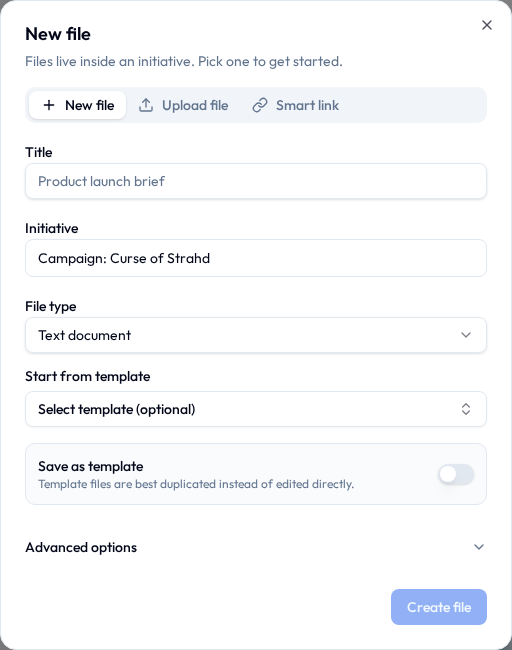
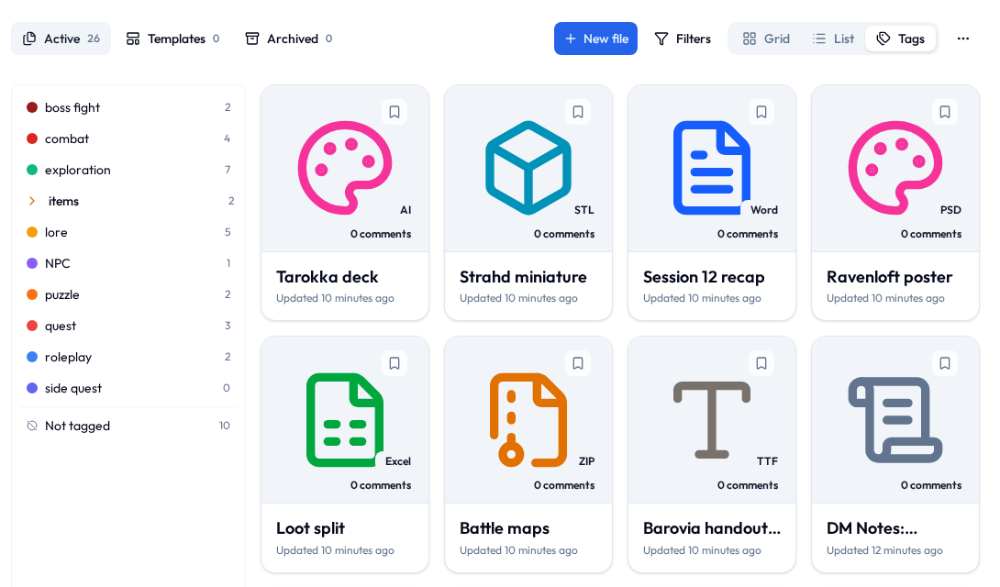
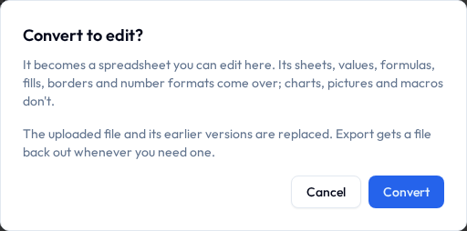

# Files

**Files** is where your group writes things down and keeps what it's been sent: the plan, the script, the budget, the minutes, the forty-minute recording of the PTA meeting that nobody will ever watch but everybody wants kept.

Most kinds of file can be edited by several people at the same moment, so nobody emails `budget_final_v3_ACTUAL.xlsx` around, and nobody has to wonder whether Dave is working on the old one, which he always is.

Files live inside an [initiative](initiatives.md), the shared space a group works in, and every new initiative has them switched on.

| Kind | What it's for |
|---|---|
| **Text document** | A page to write on: notes, plans, write-ups. See [Writing & formatting](editor.md). |
| **Spreadsheet** | Rows, columns and formulas, for numbers and lists. |
| **Whiteboard** | A blank canvas for boxes, arrows and doodles. |
| **Smart link** | A page that shows something kept somewhere else, like a video or a shared design. |
| Upload | Anything from your computer that isn't a program: PDFs, Word and Excel files, photos, fonts, 3D models, zips. |

Making files takes a role in the initiative that can create them. If you don't see **New file**, your role can't, and an initiative manager can change that (see [Initiative roles](../sharing/initiative-roles.md)).

## Make a text document, spreadsheet or whiteboard

1. Open the initiative's **Files** tab.
2. Select **New file**.
3. Type a **Title**.
4. Pick the **File type**: **Text document**, **Spreadsheet** or **Whiteboard**.
5. Optional: pick a file under **Start from template** to begin with a copy of it.
6. Optional: open **Advanced options** to choose who can open it.
7. Select **Create file**.

The file opens, ready to type in. You own it, and everyone in the initiative can view it unless you changed that in step 6. [Sharing projects & files](../sharing/sharing-projects-and-files.md) covers the rest.

{ width="520" }

## Upload a file from your computer

Any file goes except a program. Big ones are fine: a large file goes up in pieces, so if the Wi-Fi drops halfway, picking the same file again carries on from where it stopped, even after you closed the tab. The only size limit is your community's storage, if it has one, and you can have five uploads unfinished at once.

1. Open the initiative's **Files** tab.
2. Select **New file**.
3. Select the **Upload file** tab.
4. Drop the file on the box, or select **Choose a file** and pick it.
5. Change the **Title** if you like. It starts as the file's name.
6. Select **Upload file**.

It's faster to drag the file from your desktop onto the **Files** page, anywhere at all: **New file** opens on the **Upload file** tab with the file already in it.

Each upload wears its category's icon and its format on a badge (**PSD**, **ZIP**, **TTF**), so the layered poster doesn't look like the minutes.

## Add a smart link

A smart link shows something that lives elsewhere, right on its own page in Initiative: a video, a design, a shared document. Initiative saves only the address and fetches nothing from it.

1. Open the initiative's **Files** tab.
2. Select **New file**.
3. Select the **Smart link** tab.
4. Paste the address into **URL**.
5. Type a **Title**.
6. Select **Create smart link**.

These show inside the page: YouTube, Vimeo, Loom, Figma, Miro, Google Docs, Airtable and Office files. A OneDrive, SharePoint or Airtable share link needs its "embed" version, and the dialog says how to get it when you paste one. Any other address opens in a new tab with **Open in new tab**.

## Open, preview or download an upload

Open an upload from the list. Pictures, PDFs, video, audio and plain text show right on the page. A Markdown file shows formatted, with **View source** to see the raw text. Everything else says it can't be previewed and offers a download.

- **Download** saves the file to your device. Anyone who can see the file can download it.
- **Open in new tab** opens it in the browser on its own.

## Keep earlier versions of an upload

An upload keeps every version you give it, numbered and dated, so the copy from before somebody "helpfully reorganized" it is one click away.

To upload a new version (you need to be able to edit the file):

1. Open the file.
2. Select **Version history**.
3. Select **Upload new version**.
4. Pick the file.

The new one becomes the file, and the old ones stay in the list.

To look at an older version, select **Version history** and pick it. A line at the top says you're looking at an older version, and **Download** saves that one.

To delete a version for good (the file's owner can):

1. Select **Version history**.
2. Select **Delete version** (the bin) beside the version.
3. Select **Delete version** again to confirm.

Delete the newest one and the one before it becomes the file. The last version left can't be deleted.

!!! screenshot "An uploaded file's page with Version history open"
    A layered poster (PSD) with **Version history** open, showing three numbered versions and **Upload new version**, beside **Open in new tab** and **Download**. Save to `docs/en/images/files/uploaded-file.png`.

## Edit an uploaded Word or Excel file here

The budget arrived as an Excel file and the minutes as a Word file, and three people need to change both. Converting turns the upload into a spreadsheet or text document you edit in Initiative. It keeps the same name, comments and links.

1. Open the uploaded file.
2. Select **Edit**.
3. Read what comes over and what doesn't.
4. Select **Convert**.

| Uploaded as | Becomes | What comes over |
|---|---|---|
| Excel (`.xlsx`) | Spreadsheet | Sheets, values, formulas, fills, borders and number formats. Charts, pictures and macros stay behind. |
| OpenDocument (`.ods`) | Spreadsheet | Sheets, values and formulas. Formatting stays behind. |
| Older Excel (`.xls`) | Spreadsheet | Sheets and values. A formula arrives as the number it showed. |
| CSV, TSV | Spreadsheet | The rows and columns, as one sheet. |
| Word (`.docx`), OpenDocument (`.odt`) | Text document | Headings, formatting, lists, tables, links and pictures. Page layout, headers and footers, footnotes, comments and text boxes stay behind. Tracked changes arrive accepted. |
| Markdown (`.md`) | Text document | Headings, lists, tables, links and formatting. |
| Plain text (`.txt`) | Text document | The text, as paragraphs. |

Converting replaces the upload and all its earlier versions, and the dialog says so before anything happens. **Edit** shows only to people who can edit the file, and only on the newest version. When you need a Word or Excel file again, [export it](#download-a-copy-in-another-format).

{ width="520" }

## Work on a file with other people at the same time

Open a text document, spreadsheet or whiteboard that somebody else has open and you see their changes as they make them, with their name on their cursor. The badge above the file says **Online** and shows who else is in.

Changes save themselves. While **Live collaboration** is ticked (it starts ticked), every change goes to everyone straight away. Untick it and your changes go in when they're saved: **Save changes** saves them, and **Autosave** (also ticked to start with) saves for you every so often.

If your connection drops, keep going. A live file says you're offline and syncs what you did once you're back.

**Fullscreen**, above the file, gives it the whole window, and **Exit fullscreen** gives the window back.

## Give a file a featured image

A featured image runs across the top of a file, like a cover. Anyone who can edit the file can add one.

1. Open the file.
2. Select **Add featured image**.
3. Select **Upload an image**, or **Choose from Files** for a picture already in Files. On the phone app you can also take a photo or pick one from your library.

To change it later, use the buttons on the picture: **Upload a different image**, **Choose a different one from Files** or **Remove the featured image**.

Already have the picture in a text document? Select it and choose **Make this the featured image**.

## Work in a spreadsheet

Spreadsheets cover the everyday essentials. One holds up to 64 sheets, each up to 100,000 rows and 1,000 columns, which should cover the bake sale.

### Add a formula

1. Select a cell.
2. Type `=` and the formula, like `=SUM(B2:B20)`.
3. Press ++enter++.

Click other cells while you type to point at them, and a formula can read another sheet: `=SUM(Data!A1:A20)`. **Functions** in the toolbar inserts the common ones (**SUM**, **AVERAGE**, **MIN**, **MAX**, **COUNT**, **IF**, **ROUND** and a few more). Select a range first and an aggregate like **SUM** fills it in for you. The usual spreadsheet functions all work when typed.

### Add, rename, move or hide a sheet

- **Add sheet** (the **+** by the sheet tabs) adds one.
- Each tab's menu has **Rename**, **Duplicate**, **Move left**, **Move right**, **Hide sheet** and **Delete**.
- A hidden sheet is listed under the "hidden sheets" count beside the tabs. Pick it there to show it again.

### Bring in a sheet from a file

1. Select **Import a file** beside the sheet tabs.
2. Pick a `.csv`, `.tsv`, `.xlsx` or `.xlsm` file.

Each sheet in the file arrives as a new sheet here.

### Add, delete, hide or sort rows and columns

1. Right-click a row number or a column letter.
2. Pick what you want: **Insert row above**, **Insert column left**, **Insert multiple…**, **Delete row**, **Hide row**, **Unhide all rows**, or, for a column, **Sort A → Z** and **Sort Z → A**.

### Format cells

1. Select the cells.
2. Use the toolbar: font size, **Bold**, **Italic**, **Underline**, **Strikethrough**, alignment, **Text color**, **Fill color**, **Borders**, and a **Number format** (**Number**, **Currency**, **Percent**, **Date**) with its **Decimal places**, **Thousands separator** and how **Negative numbers** look.

**Clear formatting** puts the cells back to plain.

### Freeze the header rows

1. Select a cell in the last row (or column) that should stay put.
2. In the toolbar's **Freeze** group, select **Freeze first 1 row** (the number counts up to your cell) or the column version.

**Unfreeze all**, beside them, lets everything scroll again. On a narrow screen these sit in the **Format** menu at the end of the toolbar.

### Find and replace

1. Press ++ctrl+f++ (++cmd+f++ on a Mac).
2. Type what to look for.
3. Type the new text in **Replace with**, then select **Replace** or **Replace all**.

**Match case** and **Whole cell** narrow the search.

## Draw on a whiteboard

A whiteboard is for the thinking that refuses to become a paragraph: a floor plan, a seating chart, boxes and arrows that made complete sense at the time and will need explaining in March.

Draw shapes, arrows, freehand lines and text, and drop pictures in. Everyone's pointer shows up live with their name on it, so two people in different houses can point at the same box. To save it as a picture for a slide or an email, [export it](#download-a-copy-in-another-format) as PNG or SVG.

## Make a file into a template

A template is a file people make copies of rather than working in, like your meeting-notes layout or the standard event brief. It's listed with the initiative's templates, and **Start from template** in **New file** offers it.

1. Open the file.
2. Open **Status** at the top of the page.
3. Pick **Template**.

To make a new file a template from the start, turn on **Save as template** in **New file**. Pick **Active** under **Status** to turn a template back into an ordinary file.

## Find a file

Search, filters and the **Grid**, **List** and **Tags** views work as they do for every tool (see [Tools](tools.md)). Two filters are Files' own, under **Filters**:

- **Filter by type** shows one category: documents, spreadsheets, pictures, PDFs, video, design files, 3D models, fonts, camera raw, code, e-books, CAD drawings, compressed files and more.
- **Collection** shows the files in one [collection](collections.md).

## Put files in a collection

A collection gathers files that belong together, like the fall festival photos, without moving them anywhere. See [Collections](collections.md).

## Attach a file to a project

Attaching a file to a project puts it right beside the work it's for. Open the project's **Connections**, select **Add link**, find the file and pick **is attached to**. You can also drop a file from your computer onto the project's **Connections**, and the same dialog uploads and attaches it. See [Mentions & links](mentions-and-links.md#relations).

## Download a copy in another format

Exporting is for whoever can also delete the file (its owner, usually).

1. Open the file.
2. Select **Settings**.
3. Select the **Advanced** tab.
4. Under **Export**, select **Export**.
5. Pick a format.

| File | Formats |
|---|---|
| Text document | **PDF document**, **Markdown**, **Word (DOCX)**, **Importable file (.json)** |
| Spreadsheet | **CSV**, **Excel (XLSX)**, **Importable file (.json)** |
| Whiteboard | **PNG image**, **SVG image**, **Importable file (.json)** |
| Smart link | **Markdown**, **Importable file (.json)** |
| Upload | **Original file** |

An importable file comes back in with **More actions** › **Import from file** on any initiative's **Files** tab, here or on another server. An initiative with **Keep content in this initiative** switched on exports nothing.

To export several at once, select **More actions** › **Select items** on the **Files** tab, tick the files, and select **Export**.

## Rename, tag, archive, duplicate or delete a file

To rename a file, type over its title at the top and select **Save**. **Settings** has the rest, in tabs:

- **Details**: name, description, tags, metadata, and the **Comments** switch.
- **Access**: who can view, edit or own it. See [Sharing projects & files](../sharing/sharing-projects-and-files.md).
- **Advanced**: **Duplicate** (here or into another initiative), **Export**, **Archive**, and **Delete**, which sends it to the trash.

Nothing deleted is gone at once. It waits in the trash until your community's retention period ends. [Tools](tools.md) covers what all of these do for every tool.
