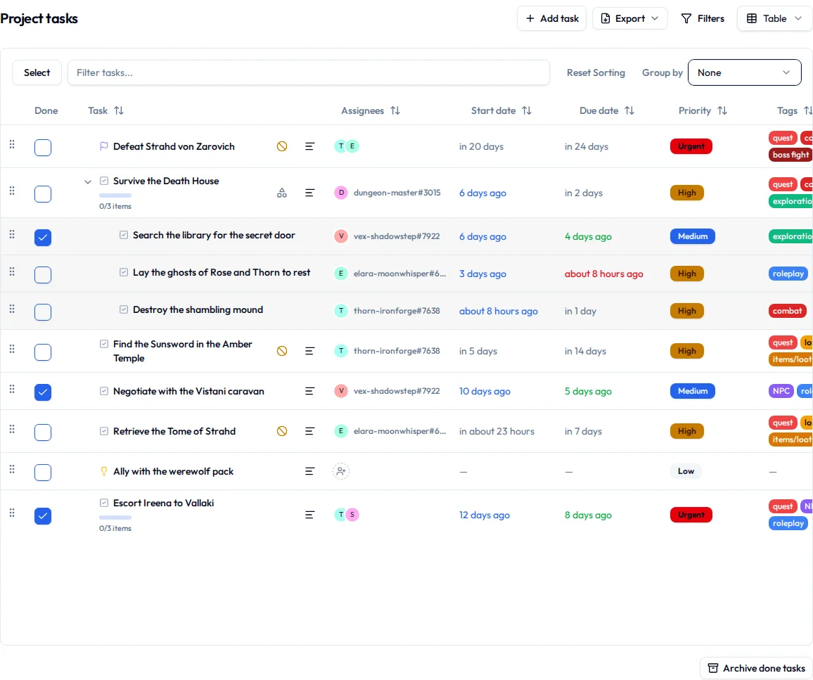
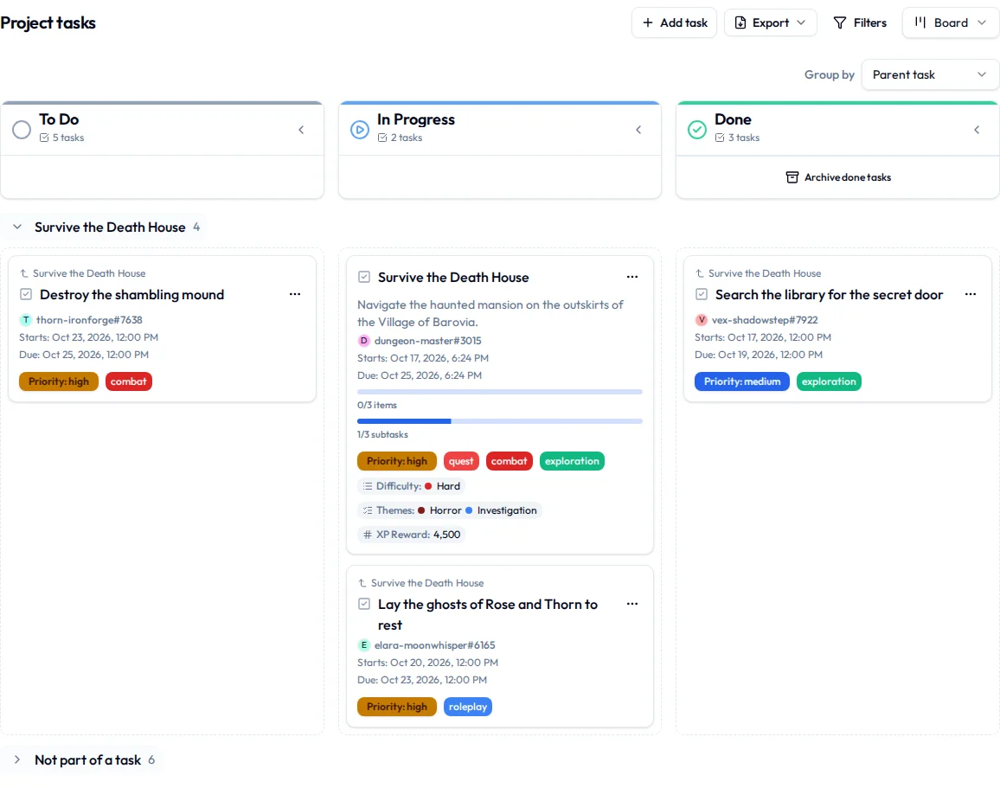

# Project views

A project's tasks can be laid out four ways: a **Table**, a **Board**, a **Gantt** chart and a **Calendar**. They're the same tasks every time. Switching only changes what's on your screen, so there's no wrong choice and nothing you can break by trying one.

Making and changing tasks themselves is on [Projects & tasks](projects-and-tasks.md).

## Switch views

1. Open the project.
2. Select the view menu at the top right of **Project tasks**. It's named for the view you're in, like **Board**.
3. Choose **Table**, **Board**, **Gantt** or **Calendar**.

Your choice is yours alone, and it follows you to any device along with your filters, sort and grouping for each view. Until you pick one, the project opens on whichever view its layouts say. A view missing from the menu has been switched off for this project; whoever looks after its [layouts](layouts.md#show-or-hide-a-view) can switch it back on.

A rough rhythm that works for most people:

- **Board** day to day, for nudging things along.
- **Table** for tidying up, sorting, or changing a lot of tasks at once.
- **Gantt** for planning ahead, or working out how bad next week is going to be.
- **Calendar** when every task has a date and the only question is "when?"

## Table

One row per task, with columns for its status, priority, dates, assignees and whatever else the project's [layout](layouts.md) adds.

- **Sort** by selecting a column heading. Hold ++shift++ and select another to sort by both. **Reset Sorting** puts the project's own order back.
- **Search titles** with the **Filter tasks...** box.
- **Finish a task** by ticking its box in the **Done** column.
- **Take a task** by selecting **Assign to me** in the **Assignees** column. If there's no such column, the project's table layout leaves it out.
- **Reorder** by dragging a row by its handle. This works while the table isn't sorted or grouped; reset both and the handles come back.
- [Subtasks](projects-and-tasks.md#subtasks) sit indented under their parent, and the arrow beside it folds them away.

**Archive done tasks**, under the table, archives every finished task in the project in one go.

## Board

Cards in columns, one column per status. Drag a card to another column as the work moves along.

- **Collapse** a column you're deliberately not thinking about with the arrow in its header.
- **Take a task** from its card's **…** menu with **Assign to me** (or **Unassign me**). **Move to** in the same menu sends it to another column without dragging.
- **Archive done tasks** sits at the bottom of each column in the done stage.

A column with a limit shows its open tasks against it in its header ("4 / 5"). Once it's full, nobody can add a task to it or move one in until one leaves, and what's already there stays. Limits are set in the [layout editor](layouts.md#cap-a-board-column).

What a card shows is up to the project's [layout](layouts.md). Take off what this project doesn't use and the cards get shorter and quicker to read.

## Gantt

Each task is a bar from its start date to its due date, on a timeline you scroll sideways. A task with only one date is a diamond on that day, and a task with no dates gets an empty row, waiting patiently.

It's the view for seeing what has to finish before what, and for noticing the Thursday onto which you have cheerfully scheduled six deadlines.

### Move tasks on the Gantt

- **Drag a bar** to move the task, or drag one end to change just that date.
- Move a task later and Initiative offers to move the tasks waiting on it by the same number of days: **Move as well** or **Just this one**. That way a late delivery doesn't leave six tasks starting before it arrives.
- **Drag across an empty row** to give an undated task its dates.
- **Use the keyboard** instead: up and down move between tasks, right and left open and fold a task's parts, and ++enter++ opens one. ++alt++ with left or right moves a task a day, and adding ++shift++ moves only its due date.

You need edit access to the project to move anything.

### Link tasks on the Gantt

- **Arrows** run from a task to the ones [blocked by](projects-and-tasks.md#say-what-a-task-is-waiting-on) it. An arrow turns red when a task starts before the thing it's waiting on is done, which is your cue to have a word with somebody. Select an arrow to remove that link.
- **Drag from the dot** at the end of a bar onto another task's row, then choose **Blocked by it** or **Part of it**.
- A task's **parts** (the tasks that are part of it) sit under it and fold away with it. The thin line over its row shows how far they stretch.
- **Critical path** fades everything but the chain of tasks that decides when the work finishes. Shorten that chain and the project ends sooner. Shorten anything else and it doesn't.
- Tasks in **other projects** that yours are linked to sit in a band at the bottom, **Linked from other projects**. You can open them from here but not move them.

### Get around the Gantt

- **Day**, **Week** and **Month** set how much fits on screen, and **Today** brings you back to now.
- A repeating task shows its next few dates as dashed outlines along its row.
- **Group by** gives each group a band of its own, as on the board.

## Calendar

Tasks laid out by their start and due dates. Pick **Day**, **Week**, **Month**, **Year** or **List**, and drag a task to another day to move it. A task with no dates doesn't appear here at all, which is the point and also the catch.

The initiative's own [calendar](calendar.md) shows the same dated tasks beside everybody's events.

## Filter a project's tasks

1. Select **Filters**.
2. Set any of these: **Filter by assignee** (including **Assigned to me** and **Unassigned**), **Due filter**, **Filter by status**, **Filter by type**, **Filter by priority** and **Filter by tag**.
3. To narrow by a property or the initiative's metadata, add a condition at the bottom of the panel.
4. To include archived tasks, switch on **Show archived**.

The **Filters** button shows how many filters are on. **Clear all** takes them off again. Your filters are yours: nobody else's view changes.

### Start from a preset

A **preset** is a named set of filters, and on a table a sort, that the project offers as a starting point. Every project starts with **Incomplete**, **Unassigned** and **Mine**.

1. Select **Filters**.
2. Pick one under **Presets**.

Its filters become yours to narrow further, and the preset itself stays as it was. It also goes into the page's address, so sending somebody the link opens the list with the same preset picked. Presets are added and changed in the [layout editor](layouts.md#presets).

## Group a project's tasks

1. In the table, the board or the Gantt, open **Group by**.
2. Pick what to group by, or **None**.

You can group by anything the view's layout offers: the date window (Overdue, Today, This Week and so on), status, type, priority, assignees, tags, who created it, the **Parent task**, dates, and any choice, person or checkbox property or metadata. Each group says how many tasks it holds. A date groups by day, week, month, quarter or year, as the layout says.

On the board and in the table, dragging a task into another group changes that field. A task with two people or two tags is listed under each, and dragging it moves it out of only the group it came from. Group a board by **Parent task** and every task with subtasks gets a band holding it and its subtasks; drag a card into another band and it becomes part of that task instead.

## Change several tasks at once

You need edit access to the project, and it happens in the table.

1. Switch to **Table**.
2. Select **Select**.
3. Tick the tasks you want.
4. In the bar that appears, choose what to do:
    - **Edit** opens **Edit tasks**, for dates, assignees, status, type, priority and the repeat. Only the fields you set are changed. Select **Apply changes** when you're done.
    - **Edit Tags** adds or removes tags.
    - **Archive** archives them.
    - **Delete** sends them to the trash, after asking.
    - **Export Selected** downloads just these.
5. Select **Exit Selection** when you're finished.

## Export the task list

1. Filter the list down to the tasks you want, or select them in the table.
2. Select **Export** (or **Export Selected**).
3. Pick a format: **PDF document**, **PDF (detailed)**, **CSV**, **Excel (XLSX)**, **Markdown table** or **Markdown task list**.

The download starts when it's ready. It comes out the way you're looking at it, in your sort and your grouping, minus any groups the layout leaves out. Grouped by tag, a task with two tags turns up under both, same as on screen. The columns are the table's, properties included. **PDF (detailed)** gives each task a page with its description, checklist and comments, laid out the way the task page is, so rearranging the layout rearranges the printout.

If the initiative keeps its content in, there's no **Export** button. To export the whole project instead, see [Export a project](project-setup.md#exporting-a-project).
