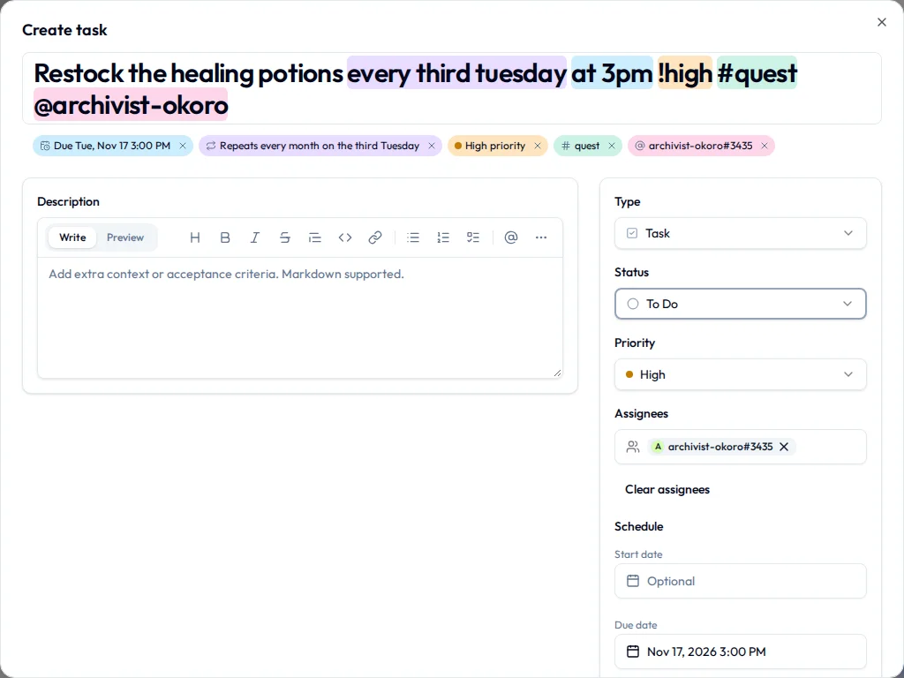

# Projects & tasks

A **project** is a list of work, and **tasks** are the things on it. If you only ever learn one part of Initiative, make it this one, because it's where most of the actual getting-things-done happens.

You can't break anything here. Every task can be changed, moved, archived and brought back, and a deleted one sits in the trash for a while in case you change your mind. How a project's tasks are shown (a table, a board, a Gantt chart or a calendar) has [a page of its own](project-views.md), and so does [setting a project up](project-setup.md) with its own statuses, kinds of task and fields.

## Make a project

You need a role in the initiative that can create projects. If there's no **Add Project** button, ask one of the initiative's managers.

1. Open the initiative and select its **Projects** tab.
2. Select **Add Project**. (On a phone, it's the **+** at the bottom of the screen.)
3. Type a **Name**.
4. Add a description, an icon, or a **Start date** and **End date** if you have them.
5. To copy a project you saved as a [template](project-setup.md#templates), pick it under **Template (optional)**.
6. To change who can see it, open **Advanced options**. Everyone in the initiative can view it unless you say otherwise.
7. Select **Create project**.

The project opens, empty and full of promise, and you're its owner. Everyone it's shared with can find it on the initiative's **Projects** tab.

## Add a task

Anyone who can edit the project can add tasks to it. If you can see a project but not its **Add task** button, ask its owner for edit access. An archived project takes no new tasks until somebody unarchives it.

### From the project

1. Open the project.
2. Select **Add task**, or press ++enter++ anywhere on the page that isn't a text box. On a phone, tap the **+** at the bottom.
3. Type a title.
4. Fill in anything else you already know. On a narrow screen, the fields you'll use less often fold away under **More options**.
5. Select **Create task**.

Nothing is saved until **Create task**, so closing the dialog throws the draft away. Once it's made, the task shows up for everyone who can see the project.

If the task's type asks for certain fields, they sit at the top of the dialog and **Create task** waits until they're filled. See [Required fields](layouts.md#required-fields).

### From anywhere else

1. Press ++ctrl+k++ (++cmd+k++ on a Mac) and choose **Add Task**, or select **Create** at the bottom right of the screen and choose **Add Task**.
2. Pick the community, the initiative and the project. The one you used last is at the top.
3. Fill in the task.
4. Select **Create task**.

### From your home page

The **My tasks** widget on your home page can have a line for adding tasks to one project of your choice. Type a title in it and select **Add**. The task is assigned to you, so it turns up in your list straight away. See [Your space](your-space.md).

## Type the details into the title { #typing-the-details-into-the-title }

A new task's title fills in the rest of the task as you type. "Email the custodian about the gym keys friday at 3pm !high #fundraiser @sam" becomes a task called "Email the custodian about the gym keys", due Friday at three, high priority, tagged fundraiser and given to Sam.

| Write | And it sets |
|---|---|
| `bug:` or the name of another of the project's task types, at the very start | The [task type](project-setup.md#task-types). |
| `today`, `tomorrow`, `friday`, `next friday`, `next week`, `in 3 days`, `oct 30` | The due date. A date on its own is due by the end of that day. |
| `at 3pm`, `9:30am`, `17:00`, `noon` | The time it's due. A time with no date is today's, or tomorrow's if today's has already gone by. |
| `every day`, `every other friday`, `every 3 days`, `every mon, wed and fri`, `every weekday`, `every weekend` | A repeat, starting on the next day it falls on. |
| `every third tuesday`, `every last friday of the month`, `every 1st and 15th`, `every last day of the month`, `every last weekday of the month`, `every oct 30` | A repeat by its place in the month or the year. |
| `every! 2 weeks`, `ev! month`, `every 4 hours` | A repeat counted from when you finish each one, so the lawn gets mowed two weeks after it was last mowed rather than two weeks after you first wrote it down. `ev` is short for `every`. Hourly repeats always count this way. |
| `until dec 18` or `10 times`, after any repeat | When the repeat stops. |
| `!urgent`, `!high`, `!medium`, `!low`, or `!1` (urgent) to `!4` (low) | The priority. |
| `#name` | A tag the community already has. `#bake-sale` finds "Bake sale". |
| `@name`, `@me` | Somebody who can open the project. Type `@` and a list opens, so you never have to remember how Sam spells their handle. |

Whatever it reads is highlighted in the title and listed underneath as chips, and the fields below show it too, so you see exactly what you're getting before you select **Create task**. Take a chip off and its words stay in the title as you typed them, which is how you get a task that really is called "Plan next week". **What a title can say**, in the dialog, lists all of this too.

A repeat that can't be set up properly isn't set at all, and its words stay in the title. "Every third second of the month", for example.

It reads the language you've set the app in, and it works in the home page's add line too. If you'd rather your titles stayed exactly as typed, switch off **Read details from the title** in [Preferences](../account/profile-and-preferences.md#preferences).

## Change a task

Open a task by selecting its title in any view. Anyone who can edit the project can change it; everyone else sees its values without the boxes around them.

There's no **Save** button. Each field saves the moment you change it, and emptying one by mistake brings up a note with **Undo** in it.

A task can hold:

| Field | What it's for |
|---|---|
| **Title** | A short name. Always required. |
| **Description** | The detail, with formatting and a **Preview**. `@`, `#` and `[[ ]]` work here ([Mentions & links](mentions-and-links.md)), and a screenshot you paste or drag in lands where your cursor is. |
| **Type** | What kind of task it is. See [task types](project-setup.md#task-types). |
| **Status** | Where it's got to. |
| **Priority** | **Low**, **Medium**, **High** or **Urgent**. |
| **Start date** and **Due date** | When work should begin and when it's due. Both optional. |
| **Remind me** | A reminder for you alone. Nobody else sees it or gets it. |
| **Assignees** | One person or several. |
| **Repeat** | Brings the task back on a schedule. See [Make a task repeat](#make-a-task-repeat). |
| **Checklist** | The smaller steps. See [Break a task into steps](#break-a-task-into-steps). |
| **Tags** | Labels for finding things later. See [Tags](tags.md). |
| Properties and metadata | Fields your project or initiative added, such as "Cost" or "Which van". See [Add a field to a project's tasks](project-setup.md#project-properties). |

Below those sit **Connections** (what this task is linked to) and the task's comments. Everything else you can do to a task is in its **More actions** menu, the **…** at the top right.

What's on a task's page, and in what order, is the project's [layout](layouts.md) for that type of task, so yours may look a little different.

If your community has [AI features](../account/ai-features.md) switched on, **AI Generate** beside the description or the checklist drafts one for you to look over.

### Set a reminder

1. Open the task.
2. Under **Schedule**, select **Remind me**.
3. Pick a date and time.

The reminder arrives as a notification at that time, to you and nobody else. On a repeating task it moves along with each new due date, staying the same distance ahead of it. To take it off, open **Remind me** again and choose **No reminder**.

## Break a task into steps

For the tasks that are secretly three tasks in a trench coat.

1. Open the task.
2. Under **Checklist**, type a step into **Add checklist item**.
3. Press ++enter++ or select **Add**. Pressing ++enter++ leaves you ready to type the next one.

Paste a list and each line becomes its own item, which saves more of your life than it sounds like it should. Tick a step off as it's done, drag one by its handle to reorder, or delete one with its bin icon. The task shows its progress ("3/5 items") on boards and in tables, which is more motivating on a bad Tuesday than it has any right to be.

## Turn a step into a task of its own { #subtasks }

When one step turns out to need its own person, its own deadline and its own opinions, make it a **subtask**: a whole task that belongs to the one it came from.

1. Open the task.
2. On the checklist line, select **Make it a task** (the little tree icon beside the bin).

The line leaves the checklist and comes back as a task in the same project, **Part of** the one it came from. A ticked line arrives already done.

A subtask is a task like any other, with its own assignee, dates, status and comments, and it turns up in calendars and in **My tasks**. Its parent counts how many of its subtasks are done ("2/7 subtasks").

To put a task that already exists under another one:

1. Open the task that should become the subtask.
2. Under **Connections**, select **Add link**.
3. Find the parent task under **Thing**.
4. Under **Relationship**, choose **is part of**.
5. Select **Add link**.

You can also drag one task onto another on the [Gantt](project-views.md#gantt), or move a card between bands on a board grouped by **Parent task**.

## Say what a task is waiting on

A task that can't start until another one is finished is **blocked by** it.

1. Open the task that has to wait.
2. Under **Connections**, select **Add link**.
3. Find the task it's waiting on under **Thing**.
4. Under **Relationship**, choose **is blocked by**.
5. Select **Add link**.

The waiting task shows how many open tasks are holding it up, and the count drops as each one gets done. Nothing stops anybody finishing a blocked task anyway, because sometimes the thing it was waiting on turns out not to matter. On the Gantt, an arrow runs from each task to the ones waiting on it. More on links in [Mentions & links](mentions-and-links.md#connections).

## Make a task repeat

For the things that keep coming back: the weekly report, the monthly treasurer's update, taking the trash out.

1. Open the task, or start a new one.
2. Under **Repeat**, pick how often: **Daily**, **Hourly (after completion)**, **Every weekday (Mon–Fri)**, weekly, monthly or annually on the task's date, or **Custom…** for the second Tuesday, the last weekday of the month and their friends.
3. With **Custom…**, set the **Frequency**, **Repeat every**, the days it falls on, and when it **Ends** (**Never**, **On date** or **After number of occurrences**).
4. Under **Repeat strategy**, choose **On schedule** or **After completion**.

Finishing a repeating task makes the next one, so there's only ever one to deal with. The next few dates of an **On schedule** repeat are listed under the form, and they show on calendars too.

| Strategy | The next one is counted from |
|---|---|
| **On schedule** | The dates. Rent is due on the 1st even if last month's went in on the 9th. |
| **After completion** | When you finished. The plants get watered a week after you last watered them, not a week after you meant to. |

**Hourly (after completion)** is for something that needs a gap after each time, like medication every four hours. Give the first task a due date and time before you save it. **Maximum per day (optional)** caps how many happen in a day: once it's reached, or the next one would land after midnight, the next is due the following day at the first one's time. Leave it empty for no cap. The day is counted in the time zone of whoever finishes the task, so people in different places each get their own day.

Missed days don't pile up into a backlog. To change the repeat or stop it, edit it on the current task. The change counts from here on and leaves the finished ones alone.

### Change or delete one task in a series

Edit or delete a repeating task and Initiative asks which ones you mean:

| Choice | What changes |
|---|---|
| **Just this task** | This one. The next comes back the way the series was. |
| **Tasks after this point** | This one and every one after it. |
| **All tasks in the series** | Every one, finished ones included, for the things they share, such as the title, description, priority, assignees and tags. Each keeps its own dates. |

Dragging a repeating task to another date on a calendar or the Gantt asks too, without the last choice.

To skip one without finishing it (the week the trash pickup moved for the holiday), open **More actions** and select **Skip this occurrence**. The task moves on to its next date. Deleting **Just this task** does the same, unless it was the last one in the series, in which case it's deleted. Deleting **Tasks after this point** ends the repeat, and deleting **All tasks in the series** sends the finished ones to the trash too.

## Finish a task

Change its **Status** to one in the done stage, tick its box in the table, or drag its card to the done column on the board. Finished tasks stay where they are until somebody [archives them](#archive-or-delete-a-task).

Finish a task that's assigned to you and Initiative marks the occasion with confetti, a "+1 Heart", a "Natural 20" or a shower of gold coins. Pick yours, or **None** if you'd rather your accomplishments passed in dignified silence, under **Task completion feedback** in [Preferences](../account/profile-and-preferences.md#preferences). There's a sound and a vibration too, for anyone who wants the full experience. Some weeks you need the coins.

## Move a task to another project

You need edit access to both projects. Templates can't take moved tasks.

1. Open the task.
2. Open **More actions** and select **Move to project**.
3. Find the project.
4. Select **Move task**.

The one thing that catches people out: every project has its own statuses, so a moved task starts at the new project's default status. Set the right one and carry on. You haven't lost anything.

- Its type comes along if the new project has a type with the same name, and becomes that project's default type if not.
- Each of its properties keeps its value where the new project has a property with the same name and type. The rest are dropped.
- Moving it into another initiative drops the old initiative's metadata from it, and anyone assigned who can't open the new project comes off it.
- If the new project's page for this type requires something the task doesn't have, a small box asks for just those fields before the move goes through.

## Duplicate a task

1. Open the task.
2. Open **More actions** and select **Duplicate task**.

The copy appears at the end of the same project with "(Copy)" after its name, and opens. It keeps the assignees, tags, links and properties, and its checklist starts unticked, because the copy hasn't done any of it yet.

## Archive or delete a task

**Archive** a finished task to clear it off the board while keeping the record. Open it, then **More actions**, then **Archive**. To archive every finished task at once, use **Archive done tasks** at the bottom of the board's done column or under the table. Archived tasks come back into view with **Show archived** under **Filters**, and **Unarchive** in the same menu puts one back.

**Delete** a task you never want to see again:

1. Open the task.
2. Open **More actions** and select **Delete task**.
3. Select **Delete**.

It goes to the trash, where it can be restored until the community's retention period runs out. See [Trash](../account/profile-and-preferences.md#trash).

To archive, delete or change lots of tasks at once, select them in the table. See [Change several tasks at once](project-views.md#change-several-tasks-at-once).
