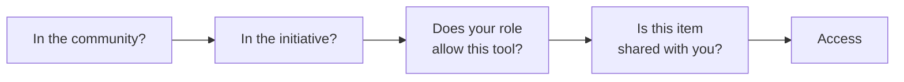

# Sharing & access

"Who can see this?" is the question people worry about most in anything shared. The short answer is the people you put in front of it, and nobody else.

Initiative answers it in **layers**, from the outside in, and each layer narrows the one before it.

## The simple version

To reach something, you clear each gate in turn:

1. **Are you in the community?** If not, you see nothing in it, and that's the end of the conversation.
2. **Are you in the initiative?** Even inside a community, an initiative's work is visible only to the people in it. This is the big one. It's how a business keeps payroll planning away from its seasonal staff in the same workspace.
3. **Does your role allow this kind of tool?** Your [initiative role](initiative-roles.md) decides which tools you can open, and which ones you can make.
4. **Is this item shared with you?** Each project, file and other tool can be shared with people, roles or the whole initiative, as a **Viewer** or an **Editor**. See [Sharing](sharing-projects-and-files.md).

It sounds like a lot to keep track of, and in practice it isn't. You join a group, join an effort, get a role, and things get shared with you. The gates do the worrying.

## Who sees more, on purpose

A few people reach further than the gates above suggest, because somebody has to be able to find the thing that went missing:

- **Community admins** can open everything in their own community, and nothing in anybody else's.
- **An initiative's Moderators** reach everything in that initiative, however each item is shared.
- **Whoever runs the server, and their staff,** get into a community only through a grant that expires on its own and leaves a record. See [Security & privacy](../security/index.md).

## Why a missing thing says "not found" rather than "denied"

If you're not in an initiative, its projects and files aren't locked doors you can rattle. As far as your account is concerned, they don't exist.

So a direct link to one says "not found" rather than "access denied". Nobody has to be told they've been left out of something, and nobody learns a thing exists by walking into a wall.

Inside an initiative you *are* in, it's friendlier. A link to something that hasn't been shared with you says **You need access** and offers **Request access**, which goes to whoever can share it. You find out it exists, and nothing else about it. See [Ask for access to something you can't open](sharing-projects-and-files.md#asking-for-access).

## In this section

-   :material-shield-account-outline: __Initiative roles__

    What roles are, what each one unlocks, and how to make your own.

    [:octicons-arrow-right-24: Initiative roles](initiative-roles.md)

-   :material-share-variant-outline: __Sharing projects, files and more__

    Share with a person, a role or the whole initiative.

    [:octicons-arrow-right-24: Sharing](sharing-projects-and-files.md)

-   :material-account-clock-outline: __Guests__

    Let somebody in for a set number of days, to only what they need.

    [:octicons-arrow-right-24: Guests](guests.md)

??? techspec "For the technically minded: where these layers are enforced"
    The community boundary is structural: each community has its own database schema, and a request is routed into one and can't reach outside it. The initiative, role and sharing layers are enforced inside that schema by PostgreSQL row-level security on every statement, so the database has the final say rather than the application. The full architecture, including the recorded path for support access, is in [How your data is kept separate](../security/how-your-data-is-kept-separate.md).
